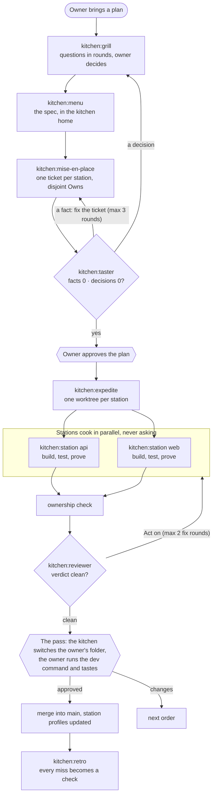

# Michelin restaurant agents

A kitchen for Claude Code, shipped as the plugin `kitchen`. The owner brings a plan. The expediter
(the main session) grills the owner, writes the spec and one ticket per station. Stations (agents)
cook in parallel on disjoint paths, prove their work through the user's door, and document it. A
reviewer judges each plate before the owner tastes it.

## How an order flows

The owner speaks only in the grill and at the two approvals (the hexagons). After the plan is
approved, nobody asks the owner anything until the pass.



The rules are in [`CLAUDE.md`](CLAUDE.md). The flow, step by step:

| Step | Skill / agent |
| --- | --- |
| Grill the owner until no question is left | `kitchen:grill` |
| Write the spec | `kitchen:menu` |
| Cut tickets, check ownership, dry-run with the taster | `kitchen:mise-en-place`, `kitchen:taster` |
| Dispatch, watch, review, decide rounds, hand off | `kitchen:expedite`, `kitchen:station`, `kitchen:reviewer` |
| Turn misses into checks | `kitchen:retro` |
| **You cook a ticket yourself**, the AI as sous-chef: it points to the file and the concept, writes the test cases, tastes your work, never writes your code | `kitchen:line` |

**When you want to cook.** Say so in the grill, or later ("I'll cook the store"). That ticket
becomes `Station: owner`: agent stations cook the boilerplate first, then you cook the main logic
in your own folder (the kitchen switches the branch). The AI gives you the file and the concept,
and goes deeper when you ask, never with code. It writes the test case descriptions, and fills
them when you say "fill". A hook blocks the AI from editing your paths until the ticket is done;
"take over" lifts it for one step and is logged.

## Install

**1. The plugin, once per machine.** Skills and agents are namespaced (`kitchen:*`), so they never
clash with a project's own `.claude/skills/` or `.claude/agents/`, and nothing is written there.

```bash
K=/path/to/michelin-restaurant-agents   # where you cloned this repo
claude plugin marketplace add "$K"
claude plugin install kitchen@kitchen-agents
# try without installing: claude --plugin-dir "$K"
```

Check it: `claude plugin list` shows `kitchen@kitchen-agents`, scope `user`, `✔ enabled`.

**After changing the kit.** A plugin installed from a folder is read from that folder (the
marketplace records its path in `~/.claude/plugins/known_marketplaces.json`), so edits take effect at
the next session start, or at once with `/reload-plugins` in a running session.

- **Edits without a version change:** nothing to run.
- **After raising `version`** in `.claude-plugin/plugin.json`: run
  `claude plugin update kitchen@kitchen-agents` so Claude Code records the new version, then restart
  Claude or run `/reload-plugins`.
- **Moving the kit folder:** run `claude plugin marketplace add <new path>` again.

**2. Nothing in the project.** Open Claude in a project or workspace folder and bring a plan:

```bash
cd <project or workspace folder>
claude
# then: your plan, or "set up the kitchen"
```

The plugin's session-start hook sees no kitchen covers the folder, and `kitchen:setup` creates one,
outside the codebase. It reads the folder, asks one round of questions (kitchen name, stations,
ports), and writes only to `~/.claude/kitchens/<name>/`. No repo, `CLAUDE.md` or `.claude/` file is
touched. Then the grill starts: grill → spec → tickets with the taster dry run → your approval →
stations cook → review → the pass.

One machine holds many kitchens, one per workspace or project:

```
~/.claude/kitchens/
  acme/                         ← Root: ~/code/acme (a workspace of 3 repos: api, web, mobile)
    kitchen.md                  root, repos, stations, shared tools
    specs/                      one spec per feature, even across repos
    stations/<name>/station.md  profile
    stations/<name>/tools/      check, prove, e2e/ … (its own git repo)
    orders/  worktrees/
  shop/                         ← Root: ~/code/shop (a single project)
```

Every session started in a kitchen's root, or any folder below it, gets that kitchen. The deepest
root wins, so a project inside a workspace can have its own kitchen.

## Scripts

```bash
python3 $K/scripts/ownership-check.py $ORDERS/<id>/ticket.md <repo or worktree> <base sha>   # exit 1 = wrote outside Owns
python3 $K/scripts/scope.py $ORDERS/<spec>-scope.json [-v]                                   # progress line for big orders
ORDERS=<home>/orders $K/scripts/watchdog.sh <worktree> <id> [minutes]   # exit 2 = station stuck
python3 $K/scripts/ownership-check.py --selftest; python3 $K/scripts/scope.py; sh $K/scripts/test-session-start.sh; sh $K/scripts/test-ownership-check.sh; sh $K/scripts/test-owner-guard.sh; python3 -I $K/scripts/kitchen.py --selftest   # and: python3 -I $K/scripts/kitchen.py check <kitchen>   # self-checks
```

## License and credits

MIT, see [`LICENSE`](LICENSE). Copyright (c) 2026 Iagor Moraes.

Parts of the skills and agents are adapted from these MIT-licensed projects. Each adapted file
names its source in its first lines, and [`NOTICE.md`](NOTICE.md) carries their full license text:

| Project | Copyright | Adapted into |
| --- | --- | --- |
| [mattpocock/skills](https://github.com/mattpocock/skills) | (c) 2026 Matt Pocock | `grill`, `menu`, `mise-en-place`, `expedite`, `retro`, the station's TDD rules, the reviewer's spec axis |
| [cursor/plugins: pstack](https://github.com/cursor/plugins/tree/main/pstack) | (c) 2026 Lauren Tan | `grill`, `menu`, `mise-en-place`, `expedite`, `retro`, the station's proof rules, the reviewer's run-to-prove rule |
